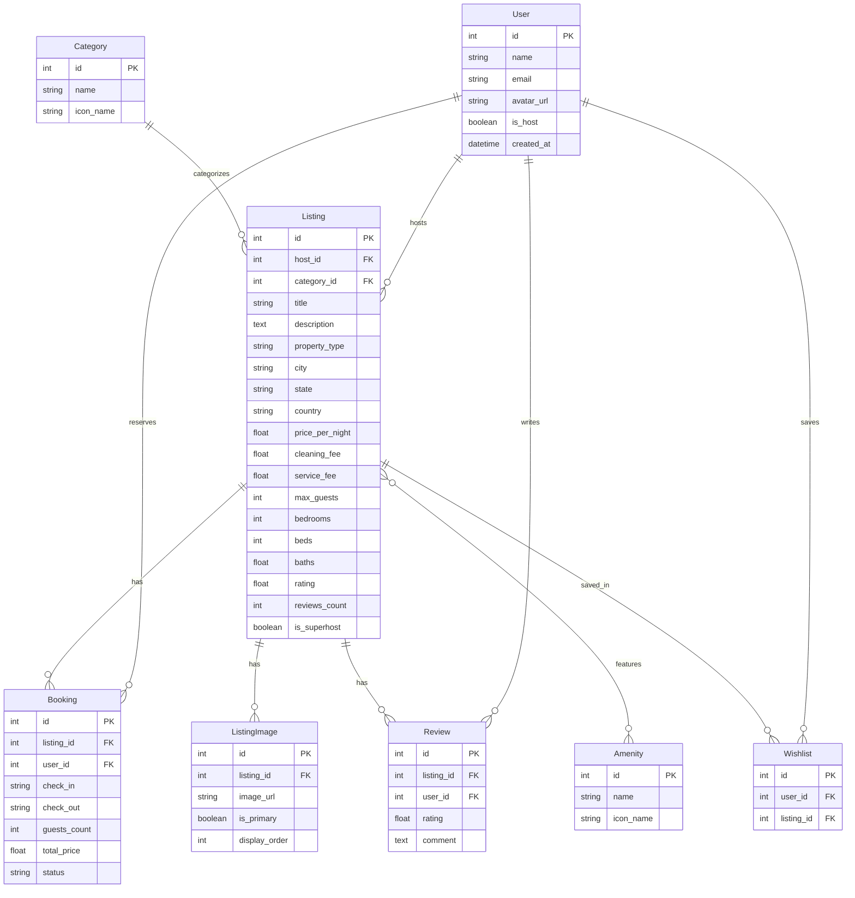

# Airbnb Full-Stack Clone

A high-fidelity, production-ready clone of Airbnb engineered from scratch with pixel-perfect UI/UX, authentic interaction patterns, and booking mechanics.

---

## 🌟 Key Features

1. **Pixel-Perfect Airbnb UI & Design System**:
   - Signature Airbnb color palette: Coral/Rausch (`#FF385C`), neutral grays (`#717171`, `#222222`), subtle borders (`#EBEBEB` / `#DDDDDD`).
   - Floating search capsule (Where | Any week | Add guests) expanding into an interactive search modal with destination suggestions, date pickers, and guest counter.
   - Horizontal scrolling category pill bar with icons (Beachfront, Cabins, Mansions, Trending, Lakefront, Amazing views, Luxe, Treehouses, etc.).
   - Photo-forward listing cards with image carousels (prev/next navigation on hover, dot indicators), wishlist heart toggle animations, star rating badges, and price breakdown.
2. **Comprehensive Listing Details (`/rooms/[id]`)**:
   - 5-photo grid layout (1 hero image + 4 sub-photos in 2x2 grid) with full-screen lightbox photo viewer.
   - Host overview with Superhost badge and avatar.
   - Property specs (guests, bedrooms, beds, baths) and amenities checklist with icons.
   - Sticky desktop reservation widget with dynamic price calculations: `nights × rate + cleaning fee + service fee = total`.
   - Live availability verification disabling conflicting booked dates.
   - Reviews breakdown with score metrics and form to leave new reviews.
3. **Atomic Booking Mechanics & Collision Prevention**:
   - Atomic collision verification: rejects any overlapping reservation (`check_in < existing_check_out` AND `check_out > existing_check_in`) with HTTP 409 Conflict.
   - Interactive checkout modal with mocked credit card payment (auto-filled test card).
   - Instant confirmation and redirect to `/trips`.
4. **Guest & Host Modes**:
   - Quick account switcher in the top navigation between Guest (`Chloe Bennett`) and Superhost (`Sarah Jenkins`).
   - **My Trips (`/trips`)**: displays confirmed and cancelled stays with dates, guest count, price paid, and cancellation action.
   - **Wishlists (`/wishlists`)**: saved dream destinations with instant optimistic heart toggle.
   - **Host Dashboard (`/host`)**: listing management with KPI revenue metrics, "Create a Listing" modal, Edit/Delete actions, and incoming guest reservations table.
   - **Re-seed Mock Data**: one-click button in the user menu to drop and repopulate the database with 16 curated high-res listings.

---

## 🏗 Tech Stack

| Layer | Technologies |
|---|---|
| **Frontend** | Next.js 14+ (App Router, TypeScript), Tailwind CSS, Lucide Icons, date-fns |
| **Backend** | Python 3.12, FastAPI, SQLAlchemy 2.0 (ORM), Pydantic v2, Uvicorn |
| **Database** | SQLite via SQLAlchemy engine (`airbnb.db`), relational schema with foreign keys and cascading deletes |

---

## 🗄 Database Schema Architecture



---

## 🚀 Running Locally

### 1. Backend Setup (FastAPI)
```bash
# In the project root:
# Install Python dependencies
python -m pip install fastapi uvicorn sqlalchemy pydantic python-multipart

# Seed the SQLite database with 16 curated listings:
python -m backend.seed

# Run the backend API server:
python -m uvicorn backend.main:app --host 127.0.0.1 --port 8000
```
Backend API will be accessible at: `http://127.0.0.1:8000`  
Interactive Swagger docs: `http://127.0.0.1:8000/docs`

### 2. Frontend Setup (Next.js)
```bash
cd frontend

# Install dependencies:
npm install

# Start the dev server:
npm run dev -- -p 3000
```
Open `http://localhost:3000` in your browser.

---

## 🔌 API Endpoints Summary

- `POST /api/seed` - Drops & re-seeds SQLite database with rich mock listings.
- `GET /api/listings` - Search and filter stays (`category`, `location`, `check_in`, `check_out`, `min_price`, `max_price`, `guests`, `property_type`). Excludes listings with overlapping bookings.
- `GET /api/listings/{id}` - Returns full listing metadata, host, images, amenities, and past reviews.
- `GET /api/listings/{id}/availability` - Returns reserved dates for calendar blocking.
- `POST /api/listings?host_id={id}` - Creates a new host listing.
- `PUT /api/listings/{id}?host_id={id}` - Updates an existing listing.
- `DELETE /api/listings/{id}?host_id={id}` - Deletes a listing.
- `POST /api/bookings` - Atomically validates date collisions and creates confirmed booking.
- `DELETE /api/bookings/{id}?user_id={id}` - Cancels a reservation.
- `GET /api/trips?user_id={id}` - Returns bookings for active user.
- `GET /api/host/dashboard?host_id={id}` - Returns host metrics, listings, and reservations.
- `POST /api/wishlist/toggle` - Adds or removes listing from wishlist.
- `GET /api/wishlists?user_id={id}` - Returns saved listings for user.
- `POST /api/reviews?listing_id={id}` - Submits a review and updates average rating.
